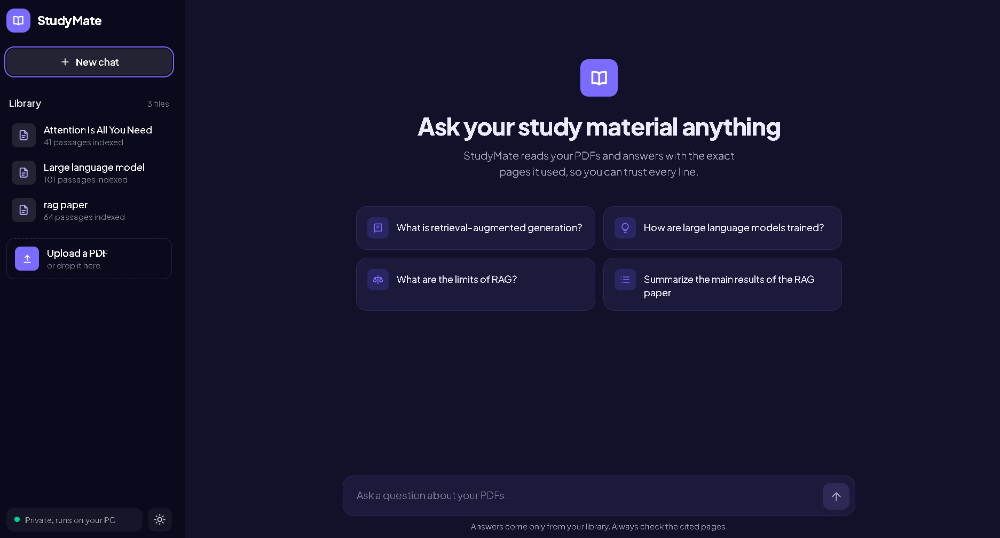
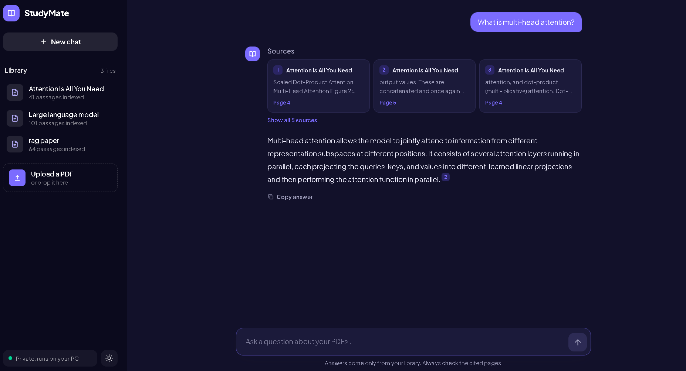
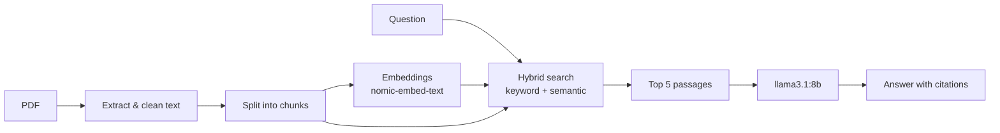

# StudyMate

**Ask questions about your PDFs and get answers with the exact page they came from.**

StudyMate is a local AI study assistant built on Retrieval-Augmented Generation (RAG). Upload lecture notes or papers, ask a question, and it answers only from your documents, citing the source page for every fact. It runs entirely on your computer, so your files never leave it.





## Features

- **Chat with your PDFs** in a clean React interface with light and dark mode
- **Cited answers**: every fact links to the source card with the file and page
- **Citation verification**: if the model cites a page it never retrieved, the citation is flagged with a "?"
- **Upload PDFs from the browser**; they are chunked and indexed automatically
- **Hybrid search** that combines keyword and semantic search
- **Fully local and private**: runs on Ollama, with no API keys and no cloud

## How it works



1. **Ingestion**: text is extracted page by page with `pypdf`, cleaned of reference markers like `[12]`, and split into 200-word chunks with a 40-word overlap.
2. **Embeddings**: each chunk is embedded with `nomic-embed-text`. Embeddings are cached on disk (SHA-256 keys), so restarts are instant.
3. **Hybrid retrieval**: keyword search and cosine-similarity search are merged with **Reciprocal Rank Fusion**.
4. **Generation**: the top 5 passages are sent to `llama3.1:8b` with a prompt that requires a citation after every fact and a refusal when the answer is not in the documents.

## Evaluation

I generated a test set of 18 questions from the documents and measured how often the right passage is retrieved.

| Retrieval method | Hit@5 | MRR |
|---|---|---|
| Keyword | 83% | 0.61 |
| Semantic | 89% | 0.77 |
| **Hybrid (RRF)** | **100%** | 0.73 |

**What I learned**
- Hybrid search found the right passage for every question, because keyword and semantic search fail on different questions.
- Cleaning the text mattered: removing Wikipedia citation markers raised semantic MRR from 0.64 to 0.77.
- Measuring first made every change a decision based on numbers, not guesses.

## Tech stack

| Layer | Technologies |
|---|---|
| AI / RAG | Python, Ollama, llama3.1:8b, nomic-embed-text, NumPy |
| Backend | FastAPI, Pydantic, Uvicorn |
| Frontend | React 19, TypeScript, Vite, Tailwind CSS v4 |
| Testing | pytest (unit tests and API tests with mocking) |

## Project structure

```
studymate/
├── app/
│   ├── ingest.py       # PDF reading, cleaning, chunking
│   ├── search.py       # keyword search
│   ├── embeddings.py   # semantic index with on-disk cache
│   ├── hybrid.py       # Reciprocal Rank Fusion
│   ├── llm.py          # prompt and Ollama call
│   ├── api.py          # FastAPI endpoints
│   └── evaluate.py     # Hit@5 and MRR evaluation
├── frontend/           # React + TypeScript + Tailwind UI
├── tests/              # pytest tests
└── docs/               # screenshots
```

## Run it locally

**Requirements:** Python 3.11+, Node.js 20+, and [Ollama](https://ollama.com).

```bash
# 1. Download the models
ollama pull llama3.1:8b
ollama pull nomic-embed-text

# 2. Backend
python -m venv .venv
.venv\Scripts\activate          # on macOS/Linux: source .venv/bin/activate
pip install -r requirements.txt
uvicorn app.api:app --reload

# 3. Frontend (in a second terminal)
cd frontend
npm install
npm run dev
```

Open http://localhost:5173 and upload a PDF. The API docs are at http://localhost:8000/docs.

**Run the tests and the evaluation**

```bash
python -m pytest
python -m app.evaluate
```

## API

| Method | Endpoint | Description |
|---|---|---|
| GET | `/health` | Health check |
| GET | `/documents` | List indexed PDFs |
| POST | `/documents` | Upload and index a PDF |
| POST | `/ask` | Ask a question and get an answer with sources |

## Roadmap

- [ ] Streaming answers, word by word
- [ ] Query rewriting for short questions and acronyms
- [ ] Docker Compose setup
- [ ] Quiz mode that generates practice questions from your notes

## Author

**Alexandra Tourgoutoglou**, Informatics graduate, University of Piraeus
[GitHub](https://github.com/atourgoutoglou)